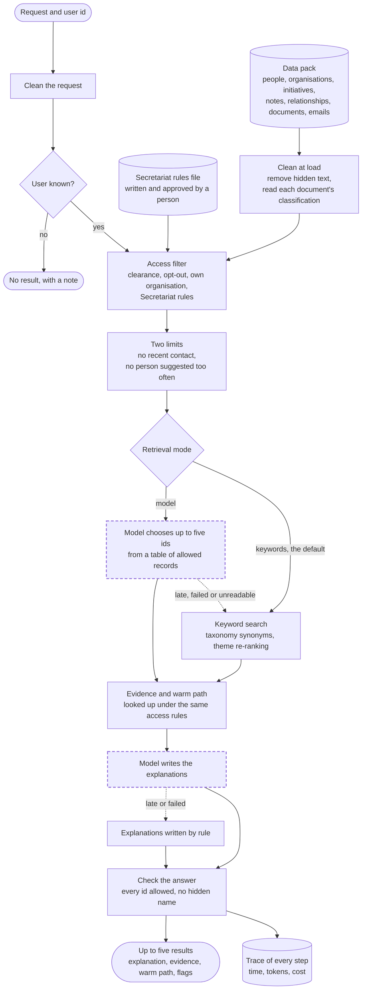
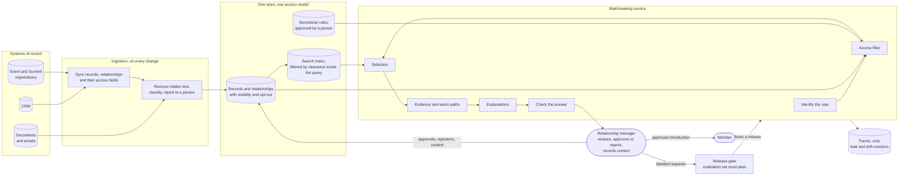

# Architecture

Two diagrams: what the prototype does today, and what it becomes in production. Steps drawn
with a dashed border call a language model. Every other step is code.

## 1. The prototype, as built

One request goes through a fixed sequence of steps. The model never decides which step runs
next.

### Who does what

| Step | Done by | Why |
|---|---|---|
| Decide what this user may be offered | Code | A filter cannot be argued with. A prompt can. |
| Leave out a recent contact, or a person already suggested twice | Code | These are suggestions the Forum does not want to make. They are removed before the ranking, so nothing can rank them back in. |
| Choose the five matches | Code by default, a model as an option | Code takes about 3 ms and gives the same answer every time. The model takes 0.6 to 1.1 s. |
| Find evidence and warm paths | Code | Code can only return a relationship that exists in the data. A model can invent one. |
| Write the explanations | Model | Turning facts into two readable sentences is what a model does well. |
| Check the answer | Code | Every id is compared with what this user may see before anything is written. |

### What has authority

- **The access fields and the Secretariat rules file.** Only these decide who may be
  offered to whom. A person writes and approves the rules file.
- **Nothing else.** Profiles, notes, documents and emails are data. Text in them that reads
  like an instruction is never followed, and hidden text is removed at load and reported
  for a person to check.

### Measured on the 10 public requests

| | Keywords (default) | Model |
|---|---|---|
| Selection | about 3 ms | 0.6 to 1.1 s |
| Whole request, median / slowest | 2.0 s / 2.9 s | 2.6 s / 3.6 s |
| Model cost per request | $0.0005 | $0.0013 |
| Tokens read by the selection | none | about 9,600, for at most 87 records |

Almost all of a request's time is the model writing the explanations.

## 2. In production

> **Proposal, to confirm.** This diagram follows the roll-out in the business memo:
> relationship managers first, a person reviewing every suggestion.

### What changes from the prototype

| | Prototype | Production |
|---|---|---|
| Data | Files read at start-up | Synced from the CRM and events on every change |
| Search | In memory, 87 records | A search index, with the access filter inside the query |
| Selection by a model | Reads a table of every allowed record | Reads a shortlist from the index (see below) |
| Explanations | Written on every request | Cached per record and clearance level, never across levels |
| Count of suggestions per person | Kept for one run of requests | The record of suggestions over a period, fed by the managers' approvals |
| Review | None: the output is a file | A relationship manager approves before anything reaches a member |
| Evaluation | 10 public requests, run by hand | A labelled set run on every change, blocking a release |

### What stays fast as the network grows

- **The access filter and the keyword search** stay in milliseconds from 5,000 profiles to
  500,000 documents, provided the filter runs inside the index query. Filtering after the
  search would return fewer than five results and take longer for users who see less.
- **The model's selection does not scale as built.** It reads about 110 tokens per record.
  At 5,000 profiles that is about 550,000 tokens per request: too slow, and about $0.055 a
  request. In production the index returns a shortlist of about 50 records and the model
  orders those.
- **The explanations are the bottleneck at the Summit peak.** One model call per request
  takes about 2 seconds, and 3,000 simultaneous calls meet the provider's rate limits. The
  ranked results can be shown first, in milliseconds. Explanations follow, from the cache
  when one exists, and written by rule when the model is late, as the prototype already
  does.
