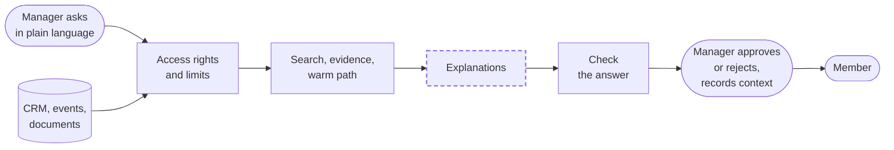

# Business framing — cross-network matchmaking

*Memo for the Head of Engineering and the Head of PR & Communications, Meridian Forum.*

## 1. The problem in business terms

Today a good introduction takes 3 to 5 working days. Its quality depends on which relationship manager picks up the request, and what a manager knows leaves with them.

We propose an MVP that proves value first. The Forum's business model does not change.

- **Primary user:** the relationship manager only. The MVP has no member self-service.
- **Decision supported:** which introduction to propose to a member. The manager decides; the tool prepares the answer.
- **Target:** a good answer in 1 hour to 1 day, instead of 3 to 5 days. The figure is set with the managers (A1).
- **Business lever:** staff productivity first, because it shows within weeks. Renewal is the end goal (section 5).

The MVP also gives managers one place to record what they know, so a junior manager works from the same context as a senior one.

**Discovery questions:**

| Topic | What we need to learn |
|---|---|
| **Capacity** | How many organisations or members does each manager handle? Does it differ by seniority or sector? |
| **Data maintenance** | Is the extract we received produced automatically or by hand? What effort keeps it up to date, the confidentiality fields above all? Who is responsible when members supply the data? |
| **Map of the knowledge** | Where does the knowledge sit today: CRM, spreadsheets, other tools, memory? |
| **The manager's job** | What does a recommendation mean, what happens when one goes wrong, and which risks are the managers comfortable taking? What stays subjective, such as phone calls and meetings, that no tool will capture? |

The relationship managers answer them: where the tool can be handed off is theirs to say.

## 2. The solution, and why

The dashed step is the only one that calls a language model.

- **Why more than one search box.** A search box returns records. An introduction also needs this user's access rights applied first, the evidence behind each match, a warm path to the person, and an explanation a manager can check. The prototype runs these as a fixed sequence with one model call: faster, cheaper, and planted text has nothing to steer. A model choosing its own tools comes later, when requests need a dialogue.
- **Where a language model is not used.** Access rights, ranking, evidence and warm paths are code: about 5 ms together, the same answer every time, and nothing written in a profile can change them. The model only writes the explanations: about 2 seconds and $0.0005 a request.

## 3. Why it answers the pain, and how it scales

**Built for every user, rolled out to relationship managers first.** The prototype answers every role in the data and is tested as if open to all. We do not recommend opening it to Summit participants yet: accuracy has to be validated over time, on the full data, and the managers are the ones who say where the tool can safely be handed off.

Scale then comes in steps: a manager reviews every suggestion; then the tool handles simple cases alone (A2); ambiguous cases stay with a manager at every stage. **We do not promise** a tool that prepares a 3,000-participant Summit on its own.

- **The Summit peak.** Ranked results need no model and come back in milliseconds. At 3,000 simultaneous requests the explanations are the bottleneck: they are cached per access level, and written by rule when the model is late.
- **The long tail of small requests.** A request costs about $0.0005 and takes no manager's time until the review.
- **From 5,000 profiles to 500,000 documents.** The access filter and the search stay in milliseconds when the filter runs inside the search index. The model never reads the network, only the five results it explains.

## 4. Risks and how we control them

Every suggestion ends in one of four outcomes.

| Suggestion | Manager | What it means | Control |
|---|---|---|---|
| Wrong | Approves | The risk: a wrong introduction reaches a member. | The manager's review, before anything is sent. |
| Wrong | Rejects | The review did its job. | The rejection is recorded. It shows where the tool cannot be trusted yet. |
| Right | Approves | The tool was correct. | The approval is recorded. It shows where the tool can be trusted. |
| Right | Rejects | The manager knows something the data does not. | The reason is recorded and becomes context for the next answers. |

An introduction has value only if the two members actually connect. Only the manager can see that, by following up.

| Risk | Control |
|---|---|
| Confidentiality and access rights | Rights are applied in code before any search; every answer is checked before it leaves. 0 violations on the 10 test requests. |
| A wrong or unwelcome introduction | A manager approves every suggestion. Opt-outs and the Secretariat's rules are applied in code. |
| Popularity bias | No person is suggested more than twice in a run, and no one the member met in the last 90 days. |
| Invented relationships | Evidence and warm paths are looked up in the data by code. The model cannot add one. |
| Untrusted content in profiles | Text in a profile is data, never an instruction. Hidden text is removed and reported to a person. |

## 5. How we prove value

**North-star metric:** the share of introductions made by a relationship manager that the member judges to be a high-quality connection they could not have reached on their own.

Three leading indicators, with measures to confirm:

- **Speed:** time from a request to an answer ready to send.
- **Trust and adoption:** share of requests handled with the tool, and share of suggestions approved.
- **Shared know-how:** context entries recorded by managers, and share of answers that use one. The team is less exposed when someone is absent or leaves.

- **Baseline:** 3 to 5 working days per answer. Today's quality is not measured: the pilot's first weeks measure it on requests handled without the tool.
- **What a 90-day pilot must show:** zero leaks, a good answer within a day, a share of approved suggestions agreed beforehand, and members rating introductions above the baseline.

**Assumptions.** A1: the volume per manager is unknown, so the target is a range. A2: simple and ambiguous cases are not defined yet. A3: nothing reaches a member without a manager's approval. A4: we hold an extract and do not know how it is maintained. Full list: [`ASSUMPTIONS.md`](ASSUMPTIONS.md).
